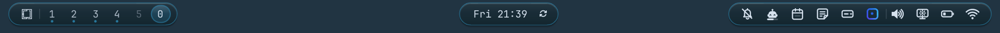

# Islands

Turns the Omarchy bar into three floating machined-glass islands (left, center, right) with a
border in your window border colors. With [Prism](https://github.com/zaki2993/zakarch.prism)
installed, the borders follow Prism live.



## Features

- **Three machined-glass islands**: the left, center and right sections float as rounded islands,
  lined up with your window gaps, with a subtle vertical surface sheen, top inner specular bevel,
  and soft shadow underneath.
- **Borders follow your windows**: color or gradient from the window border, laid out as one
  light across all three islands. With Prism, they also follow its spin, breathe and glow.
- **Cursor-tracking hover & icon pills**: sweeping over an island casts a soft radial spotlight
  along the border that follows your cursor, while individual icons get subtle concentric hover pills.
- **Hairline dividers & even icons**: subtle vertical dividers separate menu from workspaces on
  the left and custom tools from system controls on the right. Icons in the right island get the
  same gap between them and are scaled (±10%) to look the same size, whatever plugin they come from.
- **Sliding workspace capsule**: a smoothly gliding glass capsule highlights the active workspace,
  with subtle occupied dots under unfocused workspaces that have open windows (1-5 always, plus
  any other workspace in use).
- **Steady center**: hidden indicators no longer pop in when you hover the center, so the
  center island keeps its size. Indicators that are on (recording, Do Not Disturb, ...) still show.
- **Stock bar**: it restyles the stock Omarchy bar instead of replacing it, so every other
  plugin keeps working. If a future Omarchy update changes the bar internals, the islands just
  stop showing and the bar keeps working.

## Install

```bash
omarchy plugin add https://github.com/zaki2993/zakarch.islands --enable
omarchy bar move zakarch.islands --after omarchy.menu
omarchy plugin disable omarchy.workspaces
```

Islands is also the workspaces widget, so it takes the place of the stock one.

Optional: a slightly taller bar gives the islands more room. Add this to
`~/.config/omarchy/shell.toml`:

```toml
[bar]
size-horizontal = 34
```

## Remove

```bash
omarchy plugin remove zakarch.islands
omarchy plugin enable omarchy.workspaces --after omarchy.menu
```

## Files

- `Islands.qml`: the workspaces widget; it loads the painter
- `IslandPainter.qml`: finds the bar sections and draws the islands, lighting, dividers, borders, shadow and hover
- Prism state is read from `~/.local/state/omarchy/zakarch.prism/settings.json` when it exists

Note: islands only apply to a top or bottom bar. The side gap is a fixed 10px, to line up with
a Hyprland `gaps_out` of 10.
